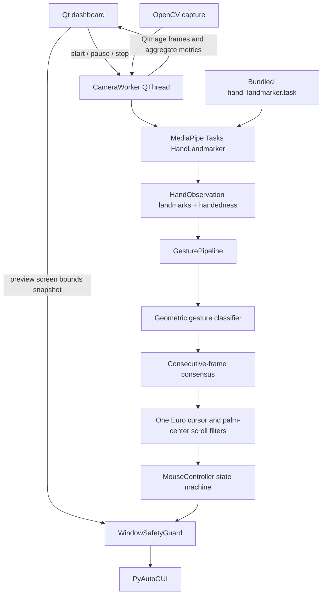

# Architecture

## Runtime flow

## Boundaries and responsibilities

- `gui.py` owns presentation, onboarding, settings widgets, navigation, and diagnostics export.
- `gui_worker.py` owns the camera/control session lifecycle on a Qt worker thread. Qt receives copied `QImage` frames and aggregate metrics; no camera buffer is shared with the UI.
- `tracker.py` adapts BGR OpenCV frames to MediaPipe Tasks VIDEO frames. It packages the result as existing `HandObservation` values so the gesture pipeline remains independent of MediaPipe result types.
- `app.py`'s `GesturePipeline` classifies raw observations, confirms temporal transitions, maps cursor coordinates, filters cursor/scroll positions, and calls the controller.
- `gestures.py`, `filters.py`, `geometry.py`, and `scrolling.py` hold deterministic logic that can be tested without physical input.
- `controller.py` owns the action state machine and PyAutoGUI boundary. A possibly held mouse button is explicitly tracked; OS input errors disable control.
- `safety.py` provides a fail-closed preview guard. The GUI publishes a lock-protected screen-space snapshot, avoiding cross-thread QWidget access.
- `config.py` validates, loads, and atomically saves settings.

## Thread and shutdown model

The UI thread never reads camera frames or runs inference. A worker owns `VideoCapture`, `HandTracker`, `GesturePipeline`, and `MouseController`. Pause and stop are cooperative requests read by the worker; cleanup releases buttons, closes the landmarker, and releases the camera. The GUI does not force-terminate a still-running worker.

NoMouse processes the newest frame available from a camera configured with a small capture buffer. OpenCV driver buffer behavior is platform-dependent; no universal latest-frame guarantee is claimed.

## Gesture and scroll design

The gesture classifier uses two-dimensional joint angles and palm-normalized pinch distance, then consecutive-frame consensus. It is a transparent geometric heuristic, not a trained classifier. The pinch ratio is configurable and clamped. No real-world precision/recall dataset exists yet.

Cursor position follows the index tip except during pinch drag, when it follows the palm landmarks. Scroll position follows the average vertical coordinate of wrist/palm MCP landmarks `(0, 5, 9, 13, 17)`, not the moving index fingertip. A separate One Euro filter feeds the rate-based `RateScroller`; neutral recentering resets that baseline. This is a geometric stability choice; real hand/camera testing is still needed to validate comfort and orientation behavior.

## Configuration and persistence

`AppConfig` is the settings schema and applies bounds/type validation to JSON values. Unknown old keys are ignored so old settings files remain readable. Writes use a temporary file followed by atomic replacement. There is not yet a formal migration/schema-version framework or multiple profile manager.

## Performance semantics

- Capture duration measures the blocking `VideoCapture.read()` call.
- Inference duration measures `HandLandmarker.detect_for_video()`.
- Decision duration measures pipeline/controller work.
- Frame processing duration includes tracking and image preparation after capture.
- p50/p95 are rolling summaries of software frame-processing time, not camera-to-photon latency.
- FPS is computed from intervals between processed frames. Intervals above 33 ms are counted as slow intervals, not a hardware-confirmed count of dropped sensor frames.

## Packaging and external components

The runtime includes the pinned MediaPipe wheel, an official local `.task` model, OpenCV, PyAutoGUI, and PySide6 Essentials. PyInstaller collects MediaPipe's package assets and native binaries into an onedir build. Camera, native window, mouse injection, UI scaling, and actual packaging behavior remain Windows hardware/system validation items.
