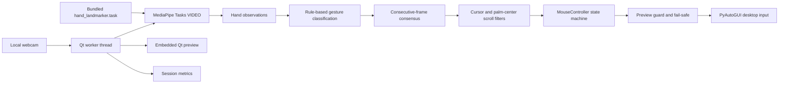

# NoMouse 3.0.0

**A local-first Windows desktop application for hands-free mouse control.** NoMouse uses a webcam and MediaPipe hand landmarks to move the pointer, click, drag, scroll, and pause control. The desktop interface embeds the camera preview, provides settings and guided setup, and keeps computer-vision processing on your device.

[](https://github.com/VarshVishwakarma/NoMouse/actions/workflows/tests.yml)

> **Hardware note:** Automated tests use synthetic hands and fake input. They verify control logic and the bundled model's software interface, but do not establish gesture accuracy, comfort, end-to-end latency, or compatibility with your camera and applications. Keep a physical mouse nearby, especially during first use.

## What it does

- **Move:** Point with your index finger.
- **Left-click:** Brief thumb-index pinch.
- **Drag:** Hold the pinch, move, then release.
- **Right-click:** Tap with two fingers while keeping the hand still.
- **Scroll:** Hold two fingers above or below the palm's gesture-start position; press **Recenter scroll neutral** on the Calibration page to establish a new baseline.
- **Browser back:** Optional four-finger pose; can be disabled in Settings.
- **Pause safely:** Use the dashboard's Pause control. Stop closes the camera session and releases controls.

The interface includes an embedded live preview, hand-landmark overlay, connection and gesture status, session-rate and processing metrics, persistent settings, first-run onboarding, calibration guidance, and aggregate diagnostic export. Diagnostics contain no camera frames or landmark coordinates.

## Install on Windows

1. Install **64-bit Python 3.11**. Python 3.10–3.12 are supported; Python 3.11 is recommended for the available security-fixed Pillow release.
2. Double-click `install_windows.bat`. It creates a local virtual environment and installs the pinned application dependencies.
3. Double-click `run_nomouse.bat`.

The first launch explains camera placement, basic gestures, pause, and the emergency stop. Choose a camera index and resolution in Settings if the default camera does not open. Grant camera access in Windows privacy settings.

For manual installation:

```powershell
py -3.11 -m venv .venv
.\.venv\Scripts\python.exe -m pip install --upgrade pip
.\.venv\Scripts\python.exe -m pip install -r requirements.txt
.\.venv\Scripts\python.exe main.py
```

Or install the package with `python -m pip install .` and run `nomouse`. `python -m nomouse` is also supported. The previous OpenCV-only control loop is still available as `nomouse-cli` or `python -m nomouse.app`.

Settings are stored in `config/settings.json` in a source checkout, or `%APPDATA%\NoMouse\settings.json` for an installed copy. Pass `--config PATH` to use another file.

## Desktop application

The sidebar provides:

- **Dashboard:** Start, Pause, Stop, live preview, recognized gesture, FPS, processing p95, and tracking status.
- **Calibration:** Camera and hand-position guidance, active-region/smoothing/scroll tuning, and a live scroll-neutral recenter action.
- **Settings:** Camera index, resolution, and requested capture rate; cursor smoothing and active margin; pinch threshold and confirmation frames; drag delay; scroll rate, deadzone, wheel step and direction; tracking confidence; and controls to enable/disable gestures and safety options.
- **Guide:** In-app explanations of the supported gestures.
- **Diagnostics:** Capture/inference/decision timing, processing p50/p95, slow frame intervals, tracking interruptions, and JSON export.

Stop the live session before applying settings. Configuration is range-checked and saved atomically. Capture FPS is a requested camera-driver target and may be ignored by some devices. The preview safety guard blocks computer-input actions when the pointer is over the embedded camera preview or when its bounds cannot be established.

### Safety and privacy

- PyAutoGUI's physical-mouse corner fail-safe remains enabled.
- The controller records a possible held button before sending a drag press. If release fails, NoMouse preserves the uncertain state, disables further control, and reports the error rather than claiming success.
- Camera frames and inference remain local. The bundled model avoids a runtime model download. No cloud account, telemetry, or recording is provided.
- NoMouse controls desktop input. Verify the target application and gesture before clicking or dragging; a physical mouse remains the recovery path.

## Performance and diagnostics

During a session the dashboard reports the camera read duration, MediaPipe inference duration, gesture/controller decision duration, application frame rate, processing p50/p95, delayed processing intervals over 33 ms, and tracking-loss transitions. The displayed processing timings exclude camera exposure and display scan-out, so they are not physical camera-to-screen latency measurements. No benchmark or universal FPS claim is made; results depend on camera and hardware.

The exported JSON contains the aggregate measurements, NoMouse version, platform description, and a small set of non-sensitive settings. It does not contain images, hand landmarks, account data, or camera recordings.

## Architecture



The GUI is in `nomouse/gui.py`; the camera/control lifecycle is in `nomouse/gui_worker.py`. `nomouse/tracker.py` owns MediaPipe Tasks, and the existing pure/testable gesture pipeline and controller remain in `nomouse/app.py`, `nomouse/gestures.py`, and `nomouse/controller.py`. Configuration and safety boundaries are implemented in `nomouse/config.py` and `nomouse/safety.py`.

The hand classifier remains a deterministic geometric ruleset, not a trained or accuracy-benchmarked model. MediaPipe supplies landmarks and handedness; NoMouse's gesture choices are derived from landmark geometry and temporal confirmation. The scroll neutral point uses the palm-center landmarks rather than the index fingertip to reduce sensitivity to finger movement. The previous `model_complexity` setting is retained for old settings files but does not choose a different Tasks model in this release.

## Development and validation

```powershell
.\.venv\Scripts\python.exe -m pip install -r requirements-dev.txt
.\.venv\Scripts\python.exe -m ruff check .
$env:QT_QPA_PLATFORM = "offscreen"
.\.venv\Scripts\python.exe -m pytest -q
```

The test suite includes unit tests, synthetic gesture-to-input pipeline checks, fault-injected mouse press/release errors, offscreen GUI/settings tests, and a MediaPipe Tasks model smoke test when runtime dependencies are installed. GitHub Actions also builds a Windows onedir package and audits the Python 3.11 runtime dependency set.

## Build a Windows application folder

`build_windows.bat` builds `dist\NoMouse\NoMouse.exe` using PyInstaller. It requires the installed application environment and PyInstaller. This is a developer build recipe, not a signed installer or a published release. Qt is distributed under its applicable LGPL/GPL or commercial terms; review `THIRD_PARTY_NOTICES.md` before redistributing a bundled build.

## Known limitations

- Windows is the primary interaction target. Linux CI coverage is for automated logic; this is not a claim of tested desktop-input support on Linux or macOS.
- The geometric gesture thresholds have no real-user precision, recall, confusion-matrix, or false-activation study.
- Camera angle, lighting, occlusion, motion blur, hand comfort, multiple simultaneous hands, and real Windows wheel-event behavior need hardware validation.
- The first version of the desktop interface has a dark theme only. Camera choices are device indices rather than an enumerated device-name list.
- Python 3.10 may resolve Pillow 12.x through transitive dependencies because Pillow 13 requires Python 3.11+. See `SECURITY.md`.
- The package build is not code-signed; no one-click public installer is published.

## Documentation and contribution

- [User guide](USER_GUIDE.md)
- [Architecture](ARCHITECTURE.md)
- [Contributing](CONTRIBUTING.md)
- [Security policy](SECURITY.md)
- [Third-party notices](THIRD_PARTY_NOTICES.md)
- [Portfolio showcase](PORTFOLIO-SHOWCASE.md)
- [Changelog](CHANGELOG.md)

NoMouse is MIT-licensed. Contributions should include focused tests and must preserve the physical emergency fail-safe and fail-closed behavior.
