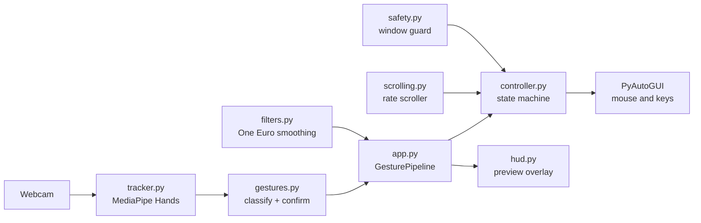

# NoMouse v2.5.3

**Control your Windows PC with your hand and a webcam.** NoMouse tracks your hand with MediaPipe, turns a handful of simple poses into mouse actions, and keeps everything on your machine: no cloud, no account, no network connection.

- **Move** the cursor by pointing your index finger.
- **Click, drag, right-click, scroll, and go back** with pinches and finger counts.
- **Fails safe.** A held drag is released if tracking is lost, the camera stops, you pause, or the app exits. Actions are blocked over the preview window, and PyAutoGUI's emergency stop stays on.

> Real-world feel depends on your webcam, lighting, and PC. The automated tests cover the control logic with synthetic hands and fake input, but they cannot judge latency or comfort on your hardware. See [Tuning](#tuning-the-feel).

## Quick start (Windows)

1. Install **Python 3.11, 64-bit** from [python.org](https://www.python.org/downloads/release/python-3119/).
2. Double-click **`install_windows.bat`**. It creates a `.venv` and installs the pinned dependencies.
3. Double-click **`run_nomouse.bat`**.

Press **H** in the preview window for an on-screen gesture guide. Keep a physical mouse nearby the first time, and test over a harmless window such as a blank Notepad document.

If anything fails, double-click **`diagnose_windows.bat`**; it prints your Python, package versions, and settings location without touching the camera or mouse.

<details>
<summary>Manual setup (PowerShell)</summary>

```powershell
py -3.11 -m venv .venv
.\.venv\Scripts\python.exe -m pip install --upgrade pip
.\.venv\Scripts\python.exe -m pip install -r requirements.txt
.\.venv\Scripts\python.exe main.py
```

Keep the package folder named `nomouse`, whatever you call the outer folder.
</details>

## Keep the preview visible during demos

The preview is configured to stay above other windows by default, so it remains visible while you click or type in a browser, editor, or desktop application. On Windows the app uses the native window manager with `NOACTIVATE`, so reasserting topmost does not intentionally steal focus from the application you are using. If the preview is accidentally minimized, the app attempts to restore it without activating it. This behavior is useful for screen recordings, but can be disabled with the **O** hotkey.

- Press **O** in the preview window to toggle always-on-top.
- `preview_always_on_top` in `config/settings.json` sets the startup default.
- Keep the preview small and move it to a corner before recording; action safety checks continue to block actions over its bounds.

## Gestures

| Action | Gesture | Notes |
|---|---|---|
| Move cursor | Index finger extended | The pointer follows your fingertip. |
| Left-click | Quick thumb-index pinch, then release | Fires on release. |
| Drag and drop | Hold the pinch (about 0.4 s) | Move your hand to drag; release the pinch to drop. |
| Double-click | Two quick pinch-and-release taps | Uses two normal clicks, so Windows' own double-click timing applies. |
| Right-click | Brief, still two-finger pose (index + middle) | Vertical movement cancels it and scrolls instead. |
| Scroll | Two fingers, then hold your hand above or below where it started | Farther from the start scrolls faster; back at the start stops. See [Scrolling](#scrolling). |
| Browser back | Four fingers up, thumb tucked | Sends `Alt`+`Left` to the foreground app. |
| Rest | Open palm or fist | No mouse action. Use **P** to genuinely pause. |

An optional three-finger double-click exists but is off by default; set `three_finger_double_click_enabled` to `true` to enable it.

### Keyboard (preview window focused)

| Key | Action |
|---|---|
| `H` | Show or hide the gesture guide (shown for a few seconds at startup) |
| `P` | Pause or resume mouse control |
| `+` / `-` | Steadier or more responsive cursor |
| `L` | Toggle hand landmarks (turn off if drawing costs you frames) |
| `O` | Toggle preview always-on-top (useful for screen recordings) |
| `Q` or `Esc` | Quit (closing the window also quits) |

Your `+`/`-` and `L` choices are saved when you quit, unless you launch with `--no-save`.

## Safety

- **Emergency stop.** Move the *physical* mouse into any screen corner and NoMouse pauses itself the next time it tries to send input. Press `P` to resume. Your hand can no longer trigger this by accident: hand-driven movement is kept a couple of pixels (`screen_edge_inset_px`) from the screen edges, so reaching for a window's close button is fine.
- **Preview-window guard.** Clicks, scrolls, and shortcuts are blocked while the pointer is over NoMouse's own preview window (the HUD shows **SAFETY HOLD**), or when its position can't be verified. Move the preview aside if you need that area.
- **Drag release.** A held drag is released on tracking loss, a camera read failure, pausing, a crash, or shutdown.
- **No actions from ambiguous frames.** One unclear frame is tolerated without breaking your gesture, but it never produces a click.
- **Local only.** Camera frames are processed on your machine and never leave it.

## Tuning the feel

Start with the defaults. If the pointer lags your hand, press `-` once or twice; if it shakes when your hand is still, press `+` once. Make small changes.

The cursor filter is adaptive: smoothing sets stability at rest, while fast movement automatically loosens it for responsiveness. It works in desktop pixels, so feel can differ between monitors and cameras. If the FPS readout in the HUD is low (amber or red), try turning landmarks off (`L`), keeping `model_complexity` at `0`, or closing other camera apps.

### Scrolling

Scrolling works like a joystick. The height where you raise two fingers (index and middle) is the **neutral point**.

1. Raise two fingers and hold still for a moment.
2. Move your hand **down** to scroll down, or **up** to scroll up. A small dead zone around neutral keeps a resting hand from scrolling.
3. The farther you move from neutral, the faster it scrolls. Return to neutral to stop.

There is nothing to re-arm, and moving back never scrolls the other way. If your hand slowly sinks while resting, the neutral point follows it.

Tuning, all in `config/settings.json`:

| Setting | Effect |
|---|---|
| `scroll_max_speed` | Top speed in wheel notches per second (default 25). |
| `scroll_full_speed_px` | How far past the dead zone you must move to reach top speed (default 200). Lower it if you want to reach top speed with less movement. |
| `scroll_deadzone_px` | Size of the neutral zone (default 20). Raise it if a resting hand drifts into scrolling. |
| `scroll_invert` | `true` flips the direction ("natural" scrolling). |
| `scroll_wheel_step` | Smallest wheel step sent, out of 120 per notch (default 40, for smooth slow scrolling). If a specific app ignores slow scrolling, set this to `120`. |

Distances are measured as if your screen were 1080 pixels tall, so scrolling feels the same on any monitor.

## Settings

Settings are a JSON file: `config/settings.json` in this folder (or `%APPDATA%\NoMouse\settings.json` if you installed with `pip`). Edit it while NoMouse is closed, or pass another file with `--config`. Values are clamped to safe ranges; unknown keys are ignored; a damaged file falls back to defaults.

| Group | Keys |
|---|---|
| Camera | `camera_index`, `camera_width`, `camera_height`, `mirror_preview` |
| Tracking | `min_detection_confidence`, `min_tracking_confidence`, `model_complexity`, `max_hands` |
| Cursor | `active_margin`, `cursor_smoothing`, `cursor_move_deadband_px`, `screen_edge_inset_px` |
| Clicks | `click_confirm_frames`, `right_click_confirm_frames`, `drag_hold_s`, `*_cooldown_s` |
| Scrolling | `scroll_deadzone_px`, `scroll_max_speed`, `scroll_full_speed_px`, `scroll_wheel_step`, `scroll_invert`, `scroll_filter_min_cutoff` |
| Interface | `hud_enabled`, `show_landmarks`, `show_help_on_start`, `safety_guard_enabled`, `preview_always_on_top` |

### Command line

```text
python main.py [--config PATH] [--camera N] [--no-save] [--version]
```

`--camera` overrides `camera_index` (handy when a virtual camera is device 0). `python -m nomouse` is equivalent to `python main.py`, and `pip install .` adds a `nomouse` command.

## Troubleshooting

| Symptom | Try |
|---|---|
| "Could not open the webcam" | Allow camera access in Windows Settings, close other apps using the camera, or try `--camera 1`. |
| "`mediapipe.solutions` is unavailable" | NoMouse needs the pinned `mediapipe==0.10.21`. Re-run `install_windows.bat` inside the project's `.venv`. |
| Setup fails on Python | Use **64-bit Python 3.11**. 32-bit builds and Python 3.13+ are not supported by the pinned packages. |
| HUD shows **SAFETY HOLD** | The pointer is over the preview window. Move the preview to another part of the screen. |
| Control paused by itself | The emergency stop fired (physical mouse in a screen corner). Press `P` to resume. |
| Clicks land slightly off target | The pointer freezes as soon as your pose stops looking like pointing. Bring your thumb to your index finger instead of curling the index toward the thumb, since a curling fingertip moves. |

## Development

```powershell
.\.venv\Scripts\python.exe -m pip install -r requirements-dev.txt
.\.venv\Scripts\python.exe -m ruff check .
.\.venv\Scripts\python.exe -m pytest -q
```

The suite runs without a webcam, MediaPipe, or a desktop session: it feeds synthetic hand landmarks through the real pipeline into a fake mouse, and it exercises the full `run()` loop with a fake camera (including "camera dies mid-drag"). GitHub Actions runs lint and tests on Windows and Linux for Python 3.10 to 3.12.

`tools/windows_scroll_diagnostic.py` sends *real* scroll events to the window under the pointer; run it only over a harmless page.

### How it fits together



```text
nomouse/
├── main.py                  launcher
├── nomouse/                 app, config, controller, filters, geometry,
│                            gestures, hud, safety, scrolling, tracker, types
├── config/settings.json
├── tests/                   unit, pipeline, and headless full-loop tests
└── tools/                   diagnose.py, windows_scroll_diagnostic.py
```

## Known limitations

- Windows-focused engineering baseline, not a calibrated accessibility product.
- Uses MediaPipe's legacy `mp.solutions.hands` API, hence the pinned dependencies.
- Pose recognition varies with camera angle, lighting, partial occlusion, and hand position.
- Scroll speed depends on how far your hand is from where the gesture began, so a long scroll session can need a re-centering pause if your hand has wandered.
- Passing tests do not replace trying it on your own camera and screen.

See [CHANGELOG.md](CHANGELOG.md) for release notes.
